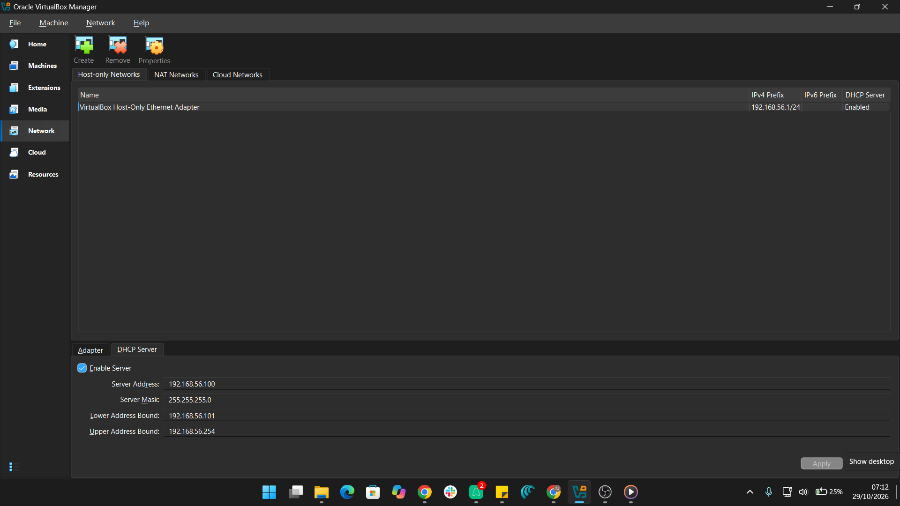
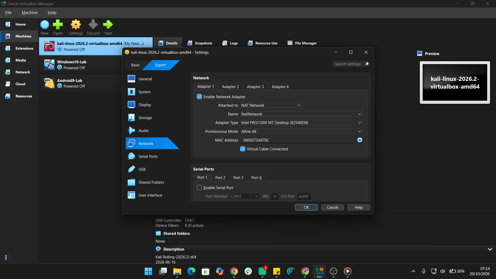

# Cybersecurity Lab Setup: Kali Linux on VirtualBox

An isolated virtual lab with a Kali Linux machine on a private VirtualBox NAT Network, built for ethical hacking and penetration testing practice.


> Week 1 project, Cybersecurity at Networkwalks (Batch B084).
> Author: **ABDULKADIRI ADARANIJO** 
---

## Objectives

- [x] Install VirtualBox and 7-Zip
- [x] Create a private NAT Network
- [x] Import Kali Linux and attach it to the NAT Network
- [x] Set a static IP on Kali
- [x] Verify connectivity and DNS
- [x] Take a clean snapshot for recovery

---

## Lab Configuration

| Component | Configuration |
|---|---|
| Host OS | Windows 11 Pro |
| Host RAM | 16 GB |
| Hypervisor | VirtualBox Version 7.2.22 |
| Security OS | Kali Linux 2026.2 |
| Kali RAM | 2048 MB |
| Virtual Network | NatNetwork (DHCP enabled) |
| Network Address | 10.0.0.0/24 |
| Kali IP | 10.0.0.2/24 |
| Gateway | 10.0.0.1 |
| DNS | 8.8.8.8 |

---

## Setup Steps

### Step 1: Install 7-Zip and VirtualBox
Installed 7-Zip to extract the Kali image, and VirtualBox as the hypervisor.

### Step 2: Create the NAT Network
Created a NAT Network named `NatNetwork` with prefix `10.0.0.0/24` and DHCP enabled. A NAT Network lets multiple VMs talk to each other while still reaching the internet.



### Step 3: Import Kali Linux
Downloaded the Kali VirtualBox image from the official site, extracted it with 7-Zip, and added it to VirtualBox.


### Step 4: Attach Kali to the NAT Network
Set Adapter 1 to **NAT Network** and selected `NatNetwork`.



### Step 5: Set the static IP
Configured Kali with IP `10.0.0.2/24`, gateway `10.0.0.1`, DNS `8.8.8.8`.


### Step 6: Take a clean snapshot
Created a snapshot named `Clean Kali - Network Setup` as a recovery baseline.


---

## Verification

| Test | Command | Result |
|---|---|---|
| IP address | `ip a` | 10.0.0.2/24 shown |
| Gateway | `ping 10.0.0.1` | Replies received |
| Internet | `ping 8.8.8.8` | Replies received |
| DNS | `networkwalks.com` | Replies received |


---

## Problems and Solutions

**Problem 1: Network dropped after setting the static IP**
Fix: disabled duplicate address detection, then restarted the connection.
```
sudo nmcli connection modify "Wired connection 1" ipv4.dad-timeout 0
sudo nmcli connection down "Wired connection 1"
sudo nmcli connection up "Wired connection 1"
```

## Additional Tasks: Windows & Android Labs

I also set up Windows and Android virtual machines in VirtualBox, following similar setup procedures and carefully applying the relevant configuration steps.


---

## What I Learned

- Difference between NAT and NAT Network
- Configuring static IPs, gateways, and DNS in Kali
- Troubleshooting VM network issues
- Using snapshots for safe recovery
- Documenting technical work clearly

---

## Tools

[7-Zip](https://7-zip.org/download.html) | [VirtualBox](https://virtualbox.org/wiki/Downloads) | [Kali Linux](https://kali.org/get-kali)
